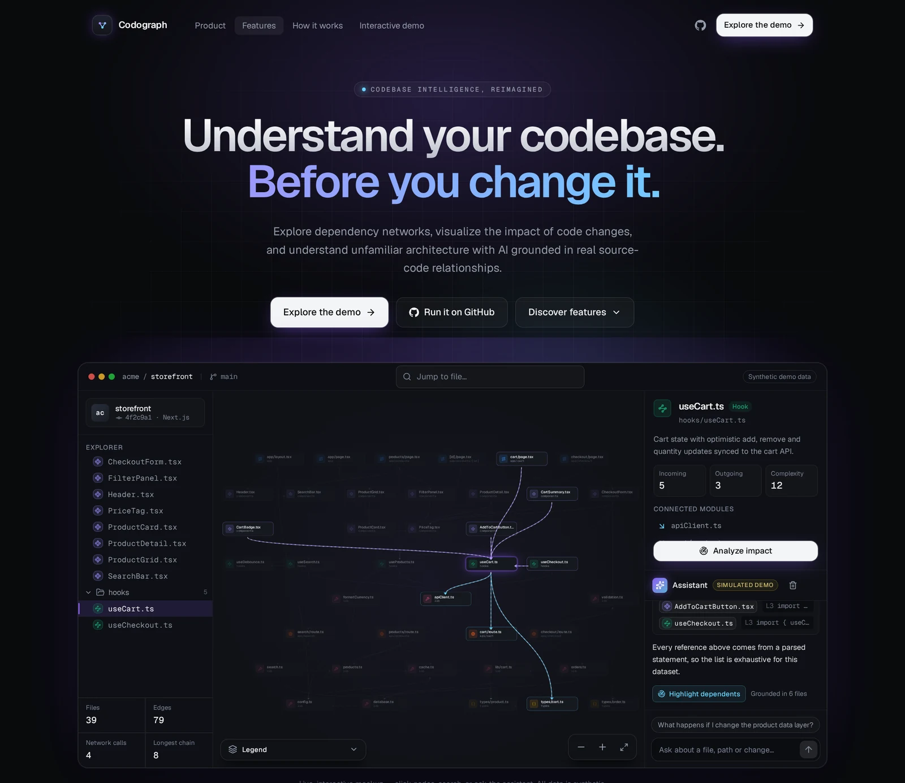
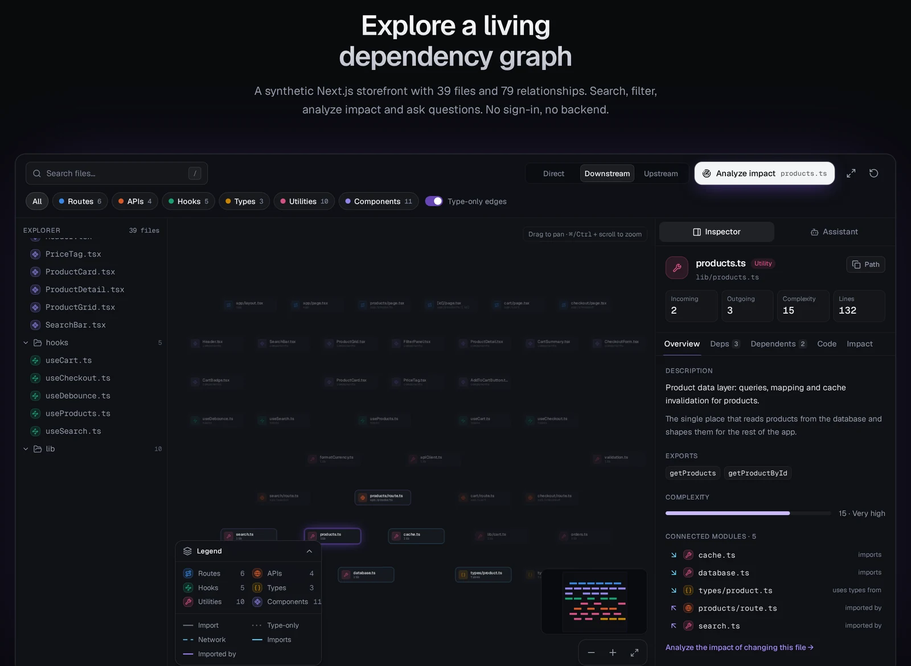
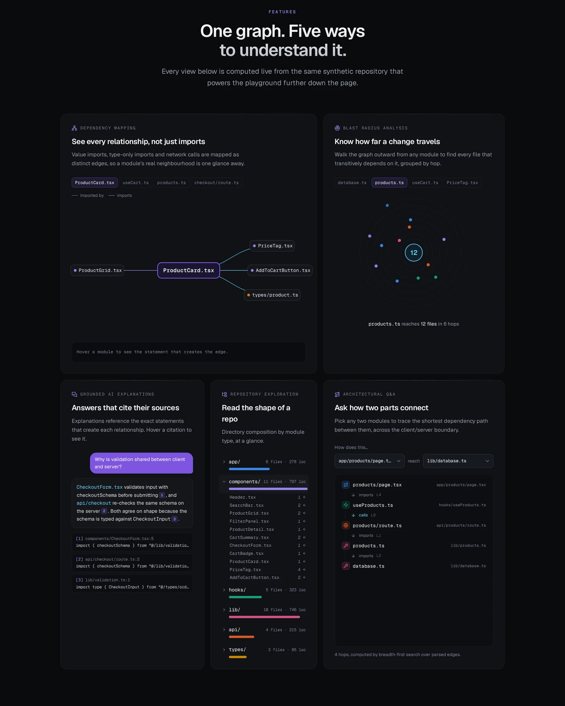

<div align="center">

<h1>&nbsp;CODOGRAPH</h1>

**Understand your codebase. Before you change it.**

Paste a public GitHub repository and get a live map of how its files depend on each other:
what a file imports, what imports it, and what breaks if it changes.

### [▶ Watch the live demo: codograph.vercel.app](https://codograph.vercel.app/)

<a href="https://codograph.vercel.app/"></a>


</div>

---

## Table of contents

1. [What is Codograph?](#what-is-codograph)
2. [Live demo vs. the real app](#live-demo-vs-the-real-app)
3. [Features](#features)
4. [Tech stack and dependencies](#tech-stack-and-dependencies)
5. [Tutorial: run the real Codograph on your machine](#tutorial-run-the-real-codograph-on-your-machine)
6. [Running the landing page](#running-the-landing-page)
7. [Useful scripts](#useful-scripts)
8. [Project structure](#project-structure)
9. [Troubleshooting](#troubleshooting)

---

## What is Codograph?

Codebases now routinely contain code nobody on the team has fully read. An agent wrote it, someone checked that it
worked, and it shipped. Over time that piles up structure nobody chose: files that import through three layers of
re-exports, a utility forty files depend on, a module nothing has used in months.

The questions that follow are structural. **What is this file? What depends on it? What breaks if it changes?**
Answering them by reading imports one file at a time stops working at around thirty files.

Codograph answers them visually. It downloads a public TypeScript or JavaScript repository, **really parses the
code** with the TypeScript compiler, and draws the result as an interactive dependency map.

Its core rule: **everything on screen comes from the parser, never from a guess.** A line between two files exists
only because the parser resolved a real import to a real file. Imports it can't resolve are reported along with the
reason. The AI only *explains* what the parser found. It never decides what's there.

---

## Live demo vs. the real app

This repository holds two separate Next.js projects:

| Folder | What it is | Needs accounts or keys? |
| --- | --- | --- |
| [`landing-page/`](landing-page) | The product site at **[codograph.vercel.app](https://codograph.vercel.app/)**. Its interactive demo runs entirely in your browser on a built-in sample repository, so you can try the map, impact analysis and search with zero setup. | No |
| [`codograph/`](codograph) | **The real product.** It analyzes any public GitHub repository you paste in, stores analyses per team, and explains files with AI. | Yes: Clerk, Supabase, and an AI key |

👉 **Just want to see it?** Open the [live demo](https://codograph.vercel.app/).
👉 **Want to use it on your own repositories?** Follow the [tutorial](#tutorial-run-the-real-codograph-on-your-machine) below.

<p align="center">
  
  <br><sub>The interactive playground on the live demo: search, filter by category, inspect any file and run an impact analysis.</sub>
</p>

---

## Features

<p align="center">
  
</p>

- **Real code parsing.** Uses `ts-morph` (the TypeScript compiler API) to resolve `import`, re-exports, dynamic
  `import()` and CommonJS `require()` into exact file-to-file edges, including `tsconfig` path aliases.
- **Interactive dependency map.** Folders are boxes and imports are lines. Open a folder into its files, then pan,
  zoom and select, all laid out automatically with React Flow and dagre.
- **Incoming and outgoing at a glance.** Select a file and the files that import it light up violet, while the files
  it imports light up cyan.
- **Impact ("blast radius").** See what breaks two levels out if a file changes, worked out by pure graph maths with
  no AI involved.
- **Detail pane.** The file's exports, its imports, what imports it, and any imports the parser could not resolve,
  each with the reason.
- **Categories and insights.** Files are grouped by role (routes, components, utilities and so on), with the most
  depended-on files and other structural facts shown alongside.
- **Framework adapters.** Recognises the kind of codebase (for example Next.js or Express) and recovers its routes.
  When a route can't be fully recovered, it shows nothing rather than guessing.
- **Paste a URL, watch it build.** Submitting a repository runs a pipeline (download → parse → store) with live
  progress over Supabase Realtime.
- **AI explanations that stay grounded.** Ask for an explanation of a file and get a paragraph written only from that
  file and its real neighbours. Answers are cached, and every call is traced in LangSmith.
- **Teams.** Sign in with Clerk and work inside an organization. Analyses belong to the team, so a repository is
  mapped once and everyone sees it.
- **Security in the database.** Postgres row-level security policies read the organization straight from the Clerk
  token, so one team can never read another team's rows.
- **Light and dark themes,** using the same violet and cyan palette as the landing page.

---

## Tech stack and dependencies

### The app ([`codograph/`](codograph))

| Package | Version | What it's for |
| --- | --- | --- |
| [Next.js](https://nextjs.org/) | 16.3.6 | Full-stack React framework (App Router, Server Actions) |
| [React](https://react.dev/) / React DOM | 19.2.8 | UI |
| [TypeScript](https://www.typescriptlang.org/) | 5 | Strict typing across the app and parser |
| [ts-morph](https://ts-morph.com/) | 28 | Parses source code and resolves imports into a dependency graph |
| [@xyflow/react](https://reactflow.dev/) (React Flow) | 12 | Interactive map canvas |
| [@dagrejs/dagre](https://github.com/dagrejs/dagre) | 3 | Automatic graph layout |
| [@clerk/nextjs](https://clerk.com/) | 7 | Sign-in, users and organizations (teams) |
| [@supabase/supabase-js](https://supabase.com/) | 2 | Postgres database, row-level security, realtime progress |
| [openai](https://github.com/openai/openai-node) | 7.23.0 | AI explanations (OpenAI, or NVIDIA NIM through the same SDK) |
| [langsmith](https://smith.langchain.com/) | 0.10.5 | Traces every AI call |
| [tar](https://github.com/isaacs/node-tar) | 7 | Unpacks downloaded GitHub repositories |
| [Tailwind CSS](https://tailwindcss.com/) | 4 | Styling |
| ESLint + eslint-config-next | 9 / 16.3.6 | Linting |

Package manager: **pnpm 10.32.1** (pinned in `package.json`).

### The landing page ([`landing-page/`](landing-page))

| Package | Version | What it's for |
| --- | --- | --- |
| Next.js | 16.4.0 | Framework (statically rendered) |
| React / React DOM | 19.3.0 | UI |
| @xyflow/react | 12 | The interactive demo map |
| motion | 14 | Animations |
| recharts | 3 | Insight charts |
| lucide-react | 1 | Icons |
| geist | 1.7 | Geist Sans and Geist Mono fonts |
| Tailwind CSS (+ @tailwindcss/turbopack) | 4 | Styling |

Package manager: **npm**.

---

## Tutorial: run the real Codograph on your machine

Allow about 15 minutes. You'll create free accounts on Clerk and Supabase, connect them, add an AI key, and start the
app.

### 1. Prerequisites

| Tool | Version | Check with |
| --- | --- | --- |
| [Git](https://git-scm.com/) | any recent | `git --version` |
| [Node.js](https://nodejs.org/) | **22.18 or newer** (24 LTS recommended) | `node -v` |
| [pnpm](https://pnpm.io/) | 10.32.1 | `pnpm -v` |

If you don't have pnpm, Node ships with Corepack, which installs the exact version this project pins:

```bash
corepack enable pnpm
```

> If `corepack enable` fails with a permissions error, run it with `sudo`, or use `npm install -g pnpm@10.32.1`.

### 2. Clone the repository and install

```bash
git clone https://github.com/notyourgiantcoder/CODOGRAPH.git
cd CODOGRAPH/codograph
pnpm install
```

### 3. Create your environment file

```bash
cp .env.example .env.local
```

You'll fill in `.env.local` over the next steps. It's ignored by git, so your keys never get committed.

### 4. Set up Clerk (sign-in and teams)

1. Create a free account at [clerk.com](https://clerk.com/) and **create an application**. Pick the sign-in methods
   you want (email, GitHub and so on).
2. Go to **Configure → Organizations** and **enable Organizations**. Codograph keeps every analysis inside a team, so
   this is required.
3. Go to **API Keys** and copy the two keys into `.env.local`:

   ```env
   NEXT_PUBLIC_CLERK_PUBLISHABLE_KEY=pk_test_...
   CLERK_SECRET_KEY=sk_test_...
   ```

   The four `NEXT_PUBLIC_CLERK_SIGN_IN_*` / `SIGN_UP_*` lines are already filled in by `.env.example`. Leave them
   as they are.

### 5. Set up Supabase (database)

1. Create a free account at [supabase.com](https://supabase.com/) and **create a new project**. Save the database
   password it asks you for.
2. Go to **Project Settings → API Keys** (and **Data API** for the URL) and copy these into `.env.local`:

   ```env
   NEXT_PUBLIC_SUPABASE_URL=https://<your-project>.supabase.co
   NEXT_PUBLIC_SUPABASE_PUBLISHABLE_KEY=sb_publishable_...
   SUPABASE_SECRET_KEY=sb_secret_...
   ```

3. **Create the tables.** The schema, security policies and realtime setup live in `codograph/supabase/migrations/`.
   Apply them with the Supabase CLI (no install needed, `npx` fetches it):

   ```bash
   npx supabase login
   npx supabase link --project-ref <your-project-ref>   # the id in your project URL
   npx supabase db push
   ```

   *Alternative:* open **SQL Editor** in the Supabase dashboard and run each file from `supabase/migrations/` in
   order, oldest timestamp first.

### 6. Connect Clerk to Supabase

This lets Supabase trust Clerk's sign-in tokens, which is how the security policies know which team you're in.

1. In **Clerk**, go to **Integrations → Supabase**, click **Activate**, and copy the **Clerk domain** it shows.
2. In **Supabase**, go to **Authentication → Sign In / Providers → Third-Party Auth**, click **Add provider →
   Clerk**, and paste that domain.

### 7. Add an AI key (for explanations)

The map works without one. Only the **Explain** feature needs an AI key. Add **one** of these to `.env.local`:

```env
# Option A: OpenAI (https://platform.openai.com/api-keys)
OPENAI_API_KEY=sk-...

# Option B: free. NVIDIA NIM (https://build.nvidia.com), used only when OPENAI_API_KEY is empty
NVIDIA_API_KEY=nvapi-...
```

### 8. Optional: LangSmith tracing

To see every AI call recorded, create a key at [smith.langchain.com](https://smith.langchain.com/):

```env
LANGSMITH_TRACING=true
LANGSMITH_API_KEY=lsv2_...
LANGSMITH_PROJECT=cartograph
LANGSMITH_ENDPOINT=https://api.smith.langchain.com
```

Without a key, tracing simply stays off and the app tells you so.

> `AGENT_URL` in `.env.example` is for a separate agent service that isn't part of this repository. You can leave it
> as it is.

### 9. Start Codograph

```bash
pnpm dev
```

Open **[http://localhost:3000](http://localhost:3000)**.

### 10. Use it

1. **Sign up.** On first sign-in Codograph puts you in an organization (your team) automatically. It joins one
   you've been invited to, or creates a new one. Invite teammates from the organization switcher in the top bar.
2. **Paste a public GitHub URL** of a TypeScript or JavaScript project, e.g. `https://github.com/vercel/next-learn`,
   and submit it.
3. **Watch the progress** as it downloads, parses and stores the repository.
4. **Open the analysis.** Click a folder to open it into files, then click a file to see what it imports (cyan), what
   imports it (violet), and its impact.
5. **Click Explain** in the detail pane for an AI summary built only from that file's real connections.
6. Use the **theme switch** in the top bar to choose system, light or dark.

### Your `.env.local` at a glance

| Variable | Required | Where to get it |
| --- | --- | --- |
| `NEXT_PUBLIC_CLERK_PUBLISHABLE_KEY` | ✅ | Clerk → API Keys |
| `CLERK_SECRET_KEY` | ✅ | Clerk → API Keys |
| `NEXT_PUBLIC_CLERK_SIGN_IN_URL` / `SIGN_UP_URL` / `*_FALLBACK_REDIRECT_URL` | ✅ | Already set in `.env.example` |
| `NEXT_PUBLIC_SUPABASE_URL` | ✅ | Supabase → Project Settings |
| `NEXT_PUBLIC_SUPABASE_PUBLISHABLE_KEY` | ✅ | Supabase → Project Settings → API Keys |
| `SUPABASE_SECRET_KEY` | ✅ | Supabase → Project Settings → API Keys |
| `OPENAI_API_KEY` *or* `NVIDIA_API_KEY` | For Explain | OpenAI or build.nvidia.com |
| `LANGSMITH_*` | Optional | smith.langchain.com |

If any ✅ variable is missing, `pnpm dev` stops right away and lists exactly which ones.

---

## Running the landing page

No accounts or keys needed:

```bash
cd CODOGRAPH/landing-page
npm install
npm run dev          # http://localhost:3000
```

Production build: `npm run build && npm start`.

**Deploying to Vercel:** import this repository at [vercel.com/new](https://vercel.com/new) and set **Root
Directory** to `landing-page`. No environment variables are needed. Every push to `main` redeploys it.

The GitHub links on the landing page come from `githubUrl` in `landing-page/lib/site.ts`.

---

## Useful scripts

Run these inside `codograph/`:

| Command | What it does |
| --- | --- |
| `pnpm dev` | Start the app in development mode |
| `pnpm build` / `pnpm start` | Production build / serve it |
| `pnpm lint` | Lint the code |
| `pnpm parse <dir>` | Run the parser on any local folder and print what it found (no accounts needed) |
| `pnpm map-counts` | Print the counts the map would show for a parse result |
| `pnpm insights` | Print the graph insights for a parse result |
| `pnpm analyze <github url> --org <clerk org id>` | Run the full pipeline from the terminal, the same code the app runs |

`pnpm parse` is a quick way to try the parser on your own project before setting anything up:

```bash
pnpm parse ../landing-page
```

---

## Project structure

```text
CODOGRAPH/
├── README.md                ← you are here
├── codograph/               ← the real app
│   ├── app/                 routes: workspace, analyses, sign-in/up, start
│   ├── components/          map, detail pane, category rail, progress, theme switch
│   ├── lib/
│   │   ├── parser/          ts-morph parser (no Next/React/database imports, runs from a plain script)
│   │   ├── graph/           pure graph maths: reach, impact, categories, insights
│   │   ├── pipeline/        download from GitHub → parse → store
│   │   ├── supabase/        server, browser and admin clients
│   │   └── ai/              the single traced AI client, prompts and tasks
│   ├── supabase/migrations/ database schema, row-level security, realtime
│   ├── scripts/             parse, analyze, map-counts, insights
│   └── docs/                product decisions and per-phase specs
└── landing-page/            ← the demo site (codograph.vercel.app)
    ├── app/                 page and global theme
    ├── components/          landing sections, demo, graph, UI primitives
    ├── data/repository.ts   the sample repository the demo runs on
    └── lib/                 graph queries, demo assistant, site config
```

---

## Troubleshooting

| Problem | Fix |
| --- | --- |
| `pnpm: command not found` | Run `corepack enable pnpm` (see [Prerequisites](#1-prerequisites)). |
| `Missing environment variables (set them in .env.local)` | The message lists which ones. Fill them in and restart `pnpm dev`. |
| "Couldn't set up an organization", or no data shows up | Make sure Organizations are enabled in Clerk **and** Clerk is added under Supabase Third-Party Auth (step 6). |
| `relation ... does not exist` | The migrations weren't applied. Run `npx supabase db push` (step 5). |
| "Neither OPENAI_API_KEY nor NVIDIA_API_KEY is set" | Add one of the two keys (step 7). Only Explain needs it. |
| A repository fails to download | It must be public. GitHub also limits anonymous requests to about 60 an hour, so wait and retry. |

